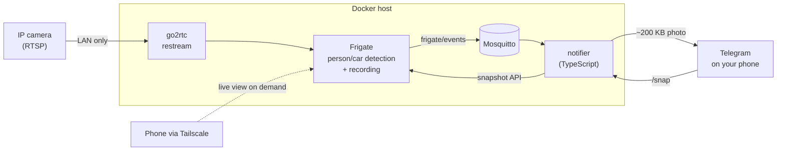

# homewatch

Self-hosted, local-first home surveillance: AI person detection, Telegram alerts with a snapshot, and live view from your phone, **without streaming video to the cloud.**

Built for a home internet plan with a monthly data cap. Video stays on the LAN. The only traffic that leaves the house is a ~200 KB snapshot per alert, plus whatever you choose to watch remotely.

## How it works



- **Frigate** runs object detection on the camera's low-res sub-stream and records the full-res stream to local disk.
- **Mosquitto** carries Frigate's detection events inside the Docker network (never exposed).
- **notifier** (in [`notifier/`](notifier/src/index.ts)) listens for events and sends a Telegram photo when a person is detected. It filters by label and confidence, sends one alert per event, and rate-limits per camera.
- **Remote live view** goes through Tailscale, so nothing is port-forwarded to the internet.

## Data usage

| Traffic | Where it goes | Counts against your quota? |
| --- | --- | --- |
| Camera stream → Frigate (24/7) | LAN | No |
| Recordings | Local disk | No |
| Alert snapshot | Telegram | ~200 KB each |
| `/snap` on demand | Telegram | ~200 KB each |
| Live view from outside | Tailscale | Only while watching |

100 alerts a day is roughly 0.6 GB a month.

## Requirements

- An always-on machine with Docker (old PC, mini PC, or Raspberry Pi 4/5)
- An RTSP camera. Defaults are set up for **TP-Link Tapo** (C200/C210/C310/C320WS); any RTSP camera works by changing the stream URLs in [`frigate/config.yml`](frigate/config.yml)
- A Telegram bot

## Setup

**1. Camera.** Add it in its own app once, then create an RTSP account (Tapo: *Camera Settings → Advanced Settings → Camera Account*). Give it a fixed IP via a DHCP reservation on your router. Optionally, block its internet access on the router; RTSP keeps working on the LAN.

**2. Telegram bot.** Message [@BotFather](https://t.me/BotFather), send `/newbot`, and copy the token. Send your bot any message, then open `https://api.telegram.org/bot<TOKEN>/getUpdates` and copy `chat.id`.

**3. Configure and run.**

```bash
git clone https://github.com/<you>/homewatch.git
cd homewatch
cp .env.example .env   # fill in camera IP/credentials and Telegram token/chat id
docker compose up -d
docker compose logs frigate | grep -i password   # first-run admin password
```

Open `https://<host-ip>:8971` and log in as `admin`.

**4. Cut false alarms.** In Frigate's UI, under *Settings → Masks / Zones*, mask out the street, trees and anything that moves on its own. Then raise `ALERT_MIN_SCORE` if needed.

**5. Remote access.** Install [Tailscale](https://tailscale.com) on the host and your phone. Open `https://<tailscale-ip>:8971` from anywhere.

## Telegram commands

| Command | What it does |
| --- | --- |
| `/snap [camera]` | Sends a live snapshot (defaults to the first camera) |
| `/cameras` | Lists configured cameras |

Only the chat in `TELEGRAM_CHAT_ID` gets answers. If the same bot is already used by another app that polls it, set `ENABLE_COMMANDS=false` (alerts still work) or create a dedicated bot.

## Configuration

| Variable | Default | Description |
| --- | --- | --- |
| `ALERT_LABELS` | `person` | Comma-separated objects that trigger alerts (`person,car,dog,cat`) |
| `ALERT_MIN_SCORE` | `0.7` | Minimum detection confidence (0–1) |
| `ALERT_COOLDOWN_SECONDS` | `120` | One alert per camera + label within this window |
| `ENABLE_COMMANDS` | `true` | Enables `/snap` and `/cameras` |
| `MEDIA_PATH` | `./media` | Where recordings and snapshots are stored |

Recording retention (3 days of motion, 7 days of snapshots) is set in `frigate/config.yml`.

## Adding cameras

Add a stream pair under `go2rtc.streams` and a matching block under `cameras` in `frigate/config.yml`. The notifier picks up new cameras automatically. For more than two or three cameras, add a Coral or OpenVINO detector instead of CPU detection.

## Privacy

Point cameras at your own property. Avoid recording neighbors, public spaces or audio of others without consent, and check local laws.

## License

MIT
